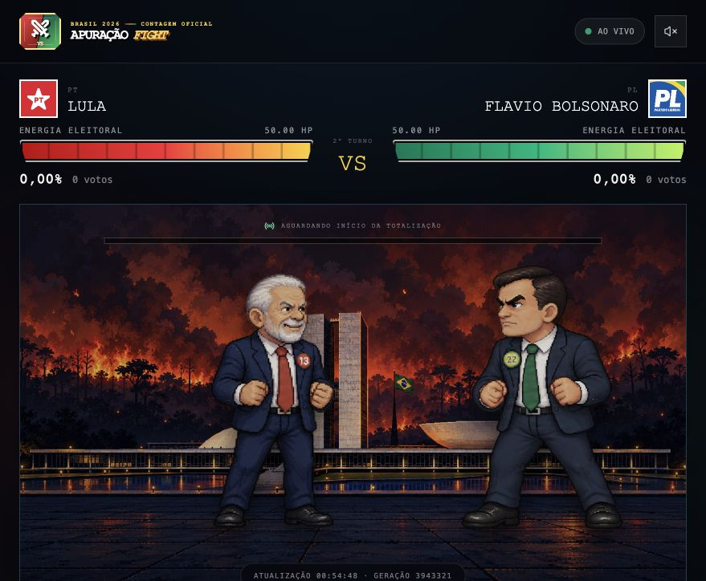

# Election Fight Live

Uma experiência independente de acompanhamento da apuração presidencial
brasileira em formato de jogo de luta pixel art. Os resultados oficiais são
transformados em golpes, animações e barras de energia atualizadas ao vivo.



> [!IMPORTANT]
> Este é um projeto independente e não possui vínculo, endosso ou associação
> com o Tribunal Superior Eleitoral (TSE), partidos ou candidaturas. Os dados
> eleitorais são obtidos do endpoint público oficial configurado na aplicação;
> em caso de divergência, prevalecem sempre os resultados publicados pelo TSE.

## Como funciona

- Um único coletor consulta o resultado oficial configurado a cada cinco
  segundos.
- Requisições condicionais com `ETag` e `Last-Modified` evitam transferências
  desnecessárias.
- Cada atualização inédita é normalizada, persistida em JSONL e publicada por
  Server-Sent Events (SSE).
- O frontend converte a evolução da apuração em ataques e calcula as barras de
  energia considerando os votos e o percentual de seções totalizadas.
- Música e efeitos são sintetizados no navegador com Web Audio API.

```text
TSE -> coletor Node.js -> snapshots + eventos SSE -> arena React
```

## Tecnologias

- Node.js 22
- React 19 e TypeScript
- Vite
- Tailwind CSS
- Server-Sent Events
- Docker

## Estrutura

```text
backend/   API, coletor do TSE, persistência e stream SSE
frontend/  interface React, sprites, animações e áudio
Dockerfile build de produção em múltiplos estágios
```

## Desenvolvimento local

Requer Node.js 22 ou superior.

```bash
npm ci
```

Inicie o backend:

```bash
npm run dev:backend
```

Em outro terminal, inicie o frontend:

```bash
npm run dev:frontend
```

A API ficará disponível em `http://127.0.0.1:3001` e a arena em
`http://127.0.0.1:5173`.

## API

| Endpoint | Finalidade |
| --- | --- |
| `GET /health` | Estado do servidor e do coletor |
| `GET /api/v1/election` | Snapshot normalizado mais recente |
| `GET /api/v1/election/history?limit=100` | Histórico em ordem cronológica |
| `GET /api/v1/events` | Stream SSE de atualizações |

As variáveis disponíveis estão documentadas em
[`backend/.env.example`](./backend/.env.example). As mais importantes em
produção são:

| Variável | Uso |
| --- | --- |
| `TSE_RESULTS_URL` | Endpoint oficial da eleição |
| `POLL_INTERVAL_MS` | Intervalo do coletor; padrão de 5 segundos |
| `PUBLIC_SITE_URL` | URL pública usada nos metadados de compartilhamento |
| `CORS_ORIGIN` | Origem autorizada a consumir a API |
| `TRUST_PROXY` | Confiança no proxy reverso; use apenas atrás de proxy confiável |

## Validação

```bash
npm run test:backend
npm run build:frontend
```

## Produção com Docker

O container serve o frontend e a API na mesma origem:

```bash
docker build -t election-fight-live .

docker run -d \
  --name election-fight-live \
  --restart unless-stopped \
  -p 3001:3001 \
  -e PUBLIC_SITE_URL=https://seu-dominio.com.br \
  -e CORS_ORIGIN=https://seu-dominio.com.br \
  -v election-fight-data:/app/backend/data \
  election-fight-live
```

Use somente **uma réplica** do backend nesta arquitetura. Réplicas adicionais
criariam coletores, históricos e streams independentes. Para domínio, HTTPS,
Cloudflare, proxy de SSE, limites de segurança e checklist de publicação,
consulte [`DEPLOYMENT.md`](./DEPLOYMENT.md).
